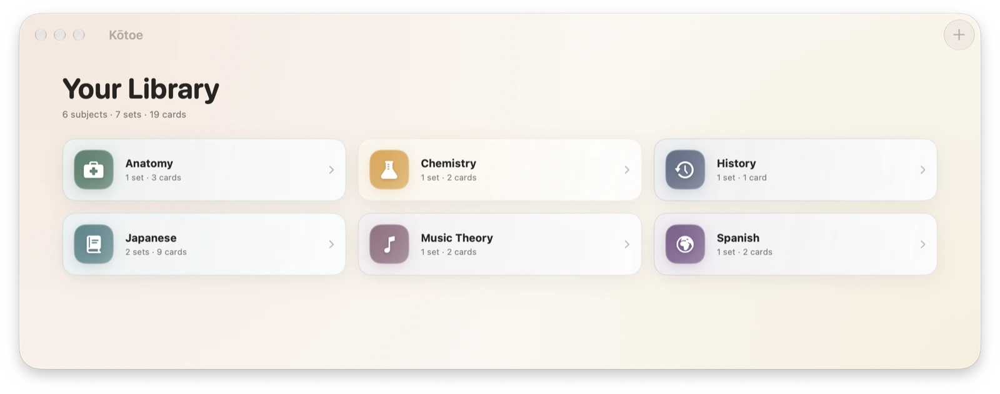
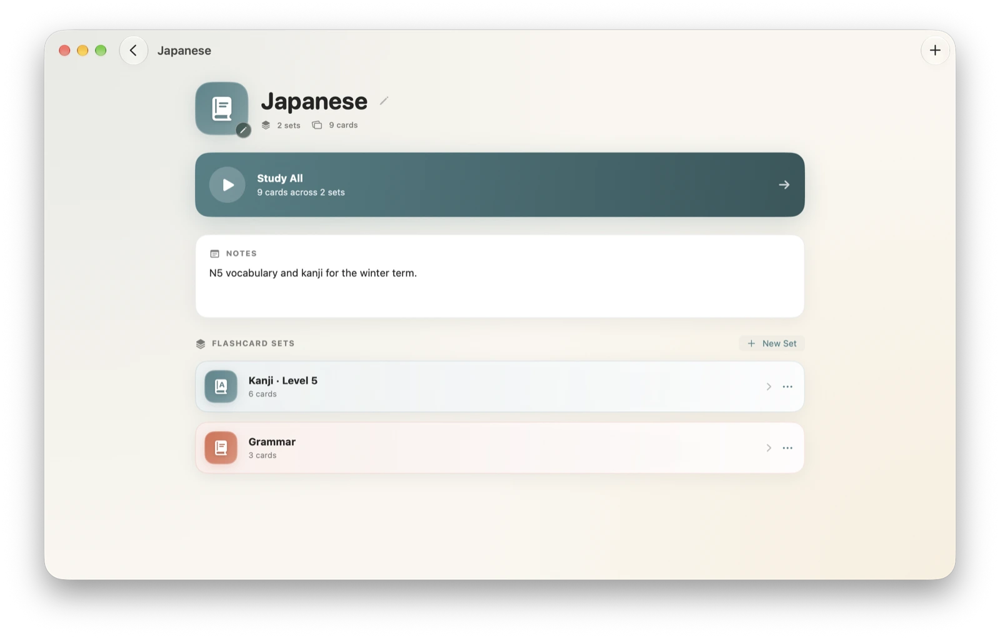
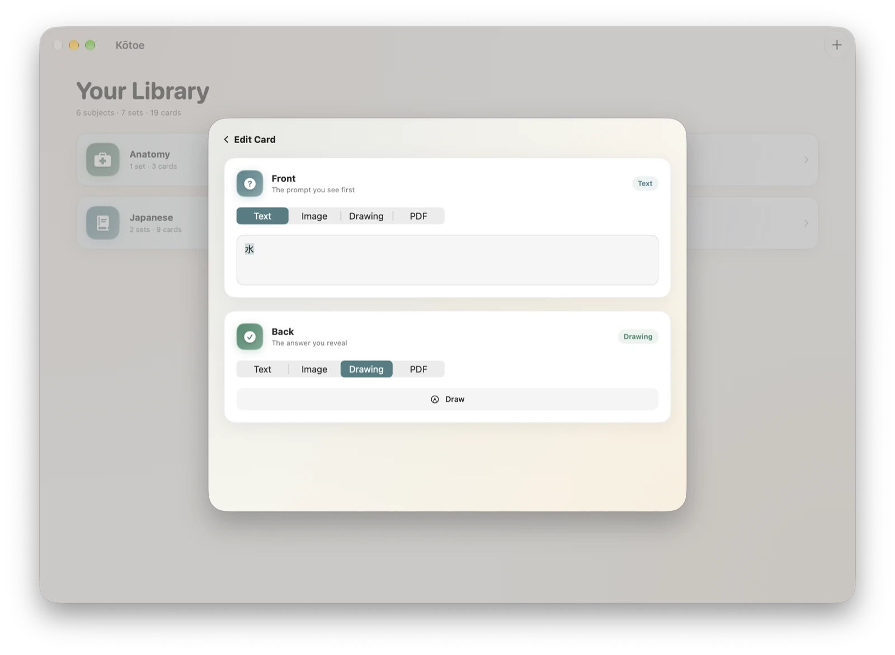
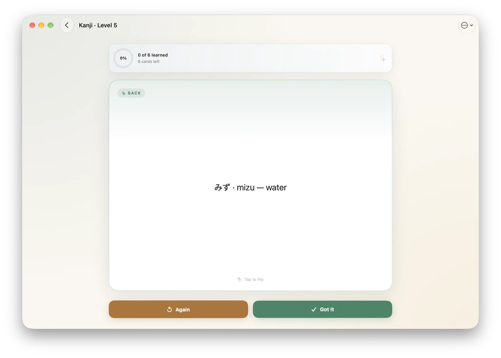
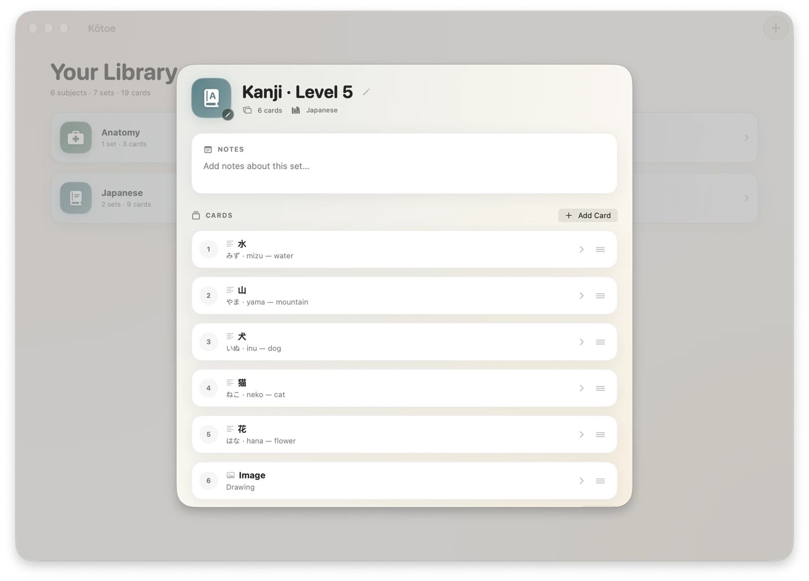
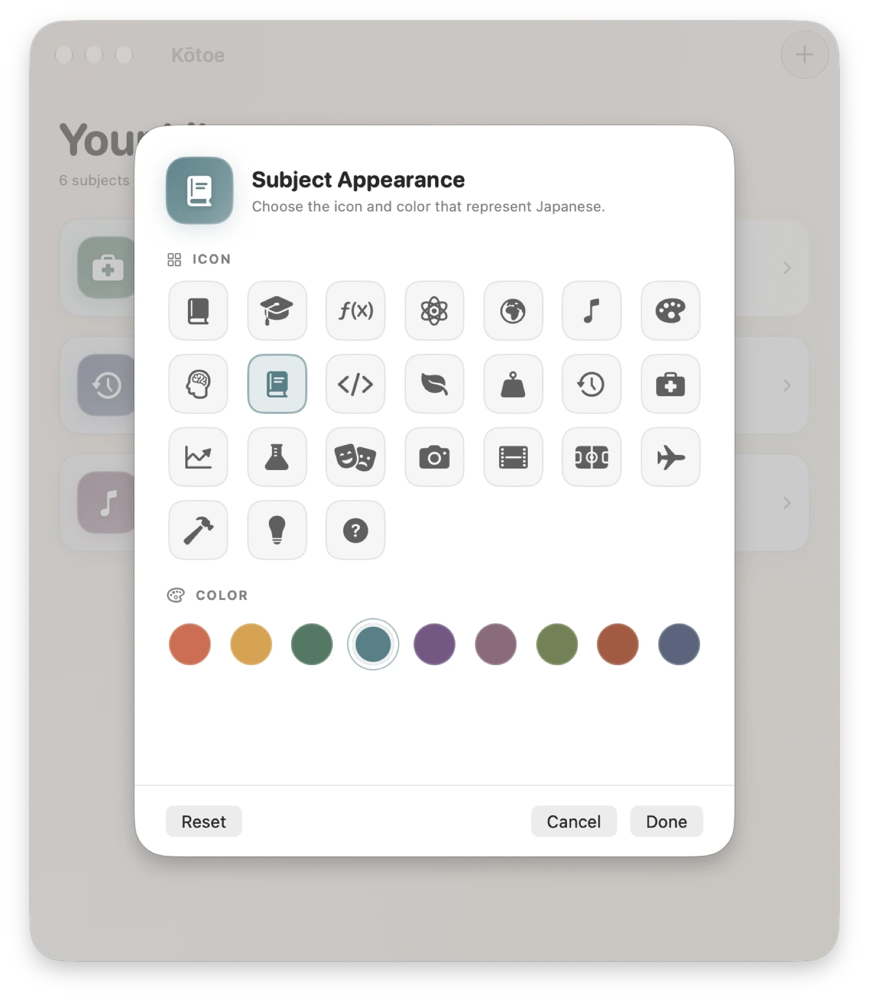
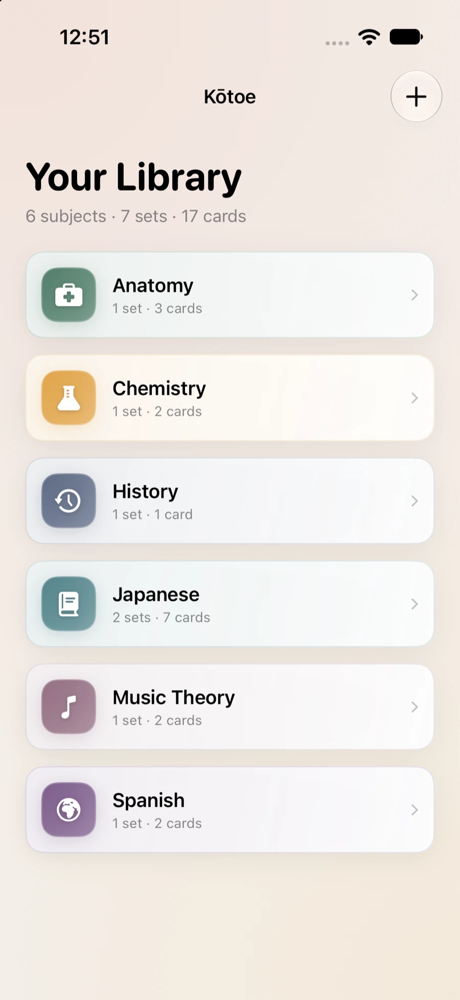
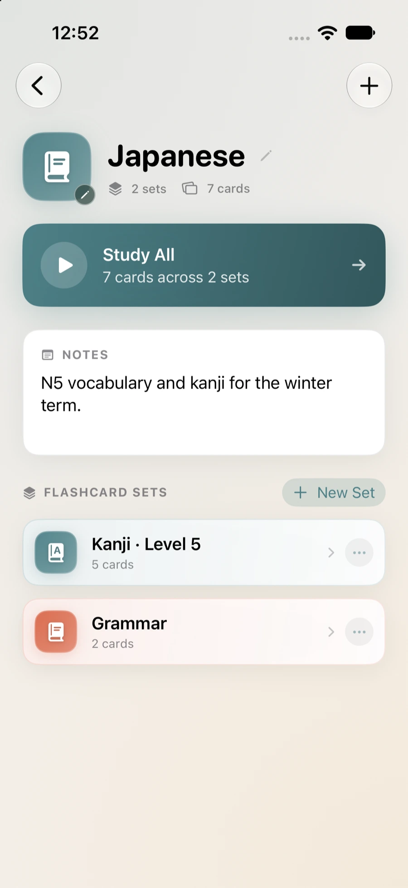
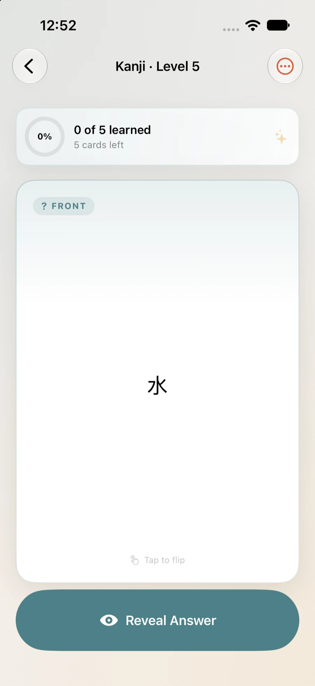

<p align="center">
  
</p>

<h1 align="center">Kōtoe</h1>

<p align="center">
  <b>A native Apple flashcard app for iOS, iPadOS and macOS.</b><br>
  Organize cards into subjects and sets, then review them in a tap-to-flip
  study session — synced across your devices with your own iCloud account.
</p>

<p align="center">
  
  
  
  
  
  
  
</p>

<p align="center">
  
</p>

---

## Features

<table>
<tr>
<td width="50%" valign="top">

### 📚 A library that thinks in subjects

Everything is a **subject → set → card → side** tree. Subjects get their own
icon and color (or let Kōtoe derive a stable one from the name), carry free-form
notes, and show a "Study All" button that mixes every set they contain.

</td>
<td width="50%" valign="top">

### 🃏 Four kinds of card content

Every side of a card can be **text**, a **photo**, a **PencilKit drawing** or a
**PDF**. Drawings are stored as vectors, PDFs are scrollable, and photos keep
their original resolution.

</td>
</tr>
<tr>
<td align="center">
  
  <br><sub>Subject detail — notes, sets and Study All</sub>
</td>
<td align="center">
  
  <br><sub>Card editor — pick a content type per side</sub>
</td>
</tr>
<tr>
<td width="50%" valign="top">

### 🔁 A study loop that keeps momentum

Tap the card to flip it, then mark it **Got It** or **Again**. Cards you miss
come back around at the end of the queue. A progress ring tracks the round,
and a shuffle option mixes the deck.

</td>
<td width="50%" valign="top">

### ☁️ Your data stays yours

The whole library syncs through **CloudKit**, and photos, drawings and PDFs
live in **iCloud Drive** as files — so full-resolution media never hits
CloudKit's 1 MB record limit. No sign-up, no server of its own, no tracking.

</td>
</tr>
<tr>
<td align="center">
  
  <br><sub>Study session — flip, then Got It or Again</sub>
</td>
<td align="center">
  
  <br><sub>Set editor — reorder, rename and add cards</sub>
</td>
</tr>
<tr>
<td align="center" colspan="2">
  
  <br><sub>Appearance editor — an icon and a color for every subject and set</sub>
</td>
</tr>
</table>

### More

- **⌨️ Keyboard first on macOS** — `⌘N` new subject, `Space` reveal, `1` / `2` to answer.
- **🎨 Appearance editor** — 24 SF Symbols and a 9-color palette for every subject and set.
- **🌍 Five languages** — English, German, Spanish, French and Japanese, shipped in a String Catalog.
- **🌓 Light and dark** — every surface adapts, and drawings are rendered on a white canvas so ink always matches.
- **📄 Real PDF viewing** — scrollable PDFKit documents right on the card.

---

## 📊 Stats

<div align="center">

| | |
|:--|:--|
| 🧑‍💻 **Lines of Swift** | **5,705** (4,511 without blanks and comments) |
| 📄 **Swift files** | **19** |
| 🗂️ **SwiftData models** | **4** |
| 🖼️ **View files** | **11** |
| 🌍 **Localized strings** | **132** keys × **5** languages |
| 🃏 **Content types per card side** | **4** (text, photo, drawing, PDF) |
| 🎨 **Palette colors** | **9** |
| 🔗 **Third-party dependencies** | **0** |
| 📱 **Platforms** | **3** (iOS, iPadOS, macOS) |

</div>

---

## 🛠️ Built with

| Layer | Technology |
| --- | --- |
| UI | SwiftUI, SF Symbols, PencilKit, PhotosUI, PDFKit |
| Data | SwiftData (`@Model`) with CloudKit mirroring |
| Files | iCloud Drive (`CloudDocuments` + ubiquity container) |
| Localization | String Catalog (`Localizable.xcstrings`) |
| Build | Xcode 27.1, `objectVersion = 77`, Swift 5 language mode |
| Targets | iOS 27.0+, iPadOS 27.0+, macOS 27.0+ |

No packages, no CocoaPods, no generated code — the whole app is the source
you see in this repository.

---

## 📱 The app on iPhone

<table>
<tr>
<td align="center"><br><sub>Library</sub></td>
<td align="center"><br><sub>Subject</sub></td>
<td align="center"><br><sub>Study</sub></td>
</tr>
</table>

---

## 🏗️ Building from source

```sh
git clone https://github.com/Erebur/Kotoe.git
cd Kotoe
open "Kōtoe.xcodeproj"
```

The project uses a **file-system synchronized group**, so every `.swift` file
under `Kotoe/` is compiled automatically — no project file editing required.

To build from the command line:

```sh
export DEVELOPER_DIR=/Applications/Xcode.app/Contents/Developer

# iOS / iPadOS
xcodebuild -project "Kōtoe.xcodeproj" -scheme "Kōtoe" \
  -destination 'generic/platform=iOS Simulator' build

# macOS
xcodebuild -project "Kōtoe.xcodeproj" -scheme "Kōtoe" \
  -destination 'platform=macOS,arch=arm64' build
```

Signing is set to team `XMGF5HVWMW` with the bundle identifier
`com.erebur.kotoe`; you will need your own Apple ID and the CloudKit
container `iCloud.com.erebur.kotoe` to run it on a device with iCloud sync.

---

## 🗺️ Roadmap

Kōtoe is still early. The core loop works today; these are the next steps.

- [ ] **Spaced repetition** — review intervals, due dates and per-card history
- [ ] **Import / export** — Anki `.apkg` and CSV round-trips
- [ ] **Search** across every subject, set and card
- [ ] **Tags** and smart collections
- [ ] **Archive** — the model already supports it, the UI does not exist yet
- [ ] **Reorder** subjects and sets by drag and drop
- [ ] **Tests** — the project has no test target yet

---

## 🧩 Project layout

```
Kotoe/
  FlashApp.swift                 @main app, SwiftData ModelContainer
  ContentView.swift              Subject list (root screen)
  Sync/                          CloudKit event observer and sync status
  Media/                         iCloud Drive file storage for card media
  Models/                        Subject, FlashcardSet, Flashcard, FlashcardSide
  Views/                         Library, study, editors, PDF and PencilKit
  Views/Helper/                  Theme, appearance editor, shared components
Localizable.xcstrings            UI copy for en, de, es, fr, ja
docs/images/                     Screenshots used in this README
LICENSE                          MIT license text, bundled into the app
```

---

## 📄 Notes

- All non-English translations are currently machine translated and have not
  been reviewed by native speakers. The app shows a disclaimer in the library
  footer when it is not running in English.
- Rich text is stored as RTF but edited and rendered as plain text for now.
- Cascade deletes applied on one device can leave a record orphaned on
  another; there is no repair pass yet.

---

## 📜 License

Kōtoe is released under the **MIT License**. The full text lives in
[`LICENSE`](LICENSE) and is bundled into the app, so it can be shown from
inside Kōtoe itself.

---

<p align="center">
  <sub>Made with Swift, on a Mac, in the spirit of a well-made paper card.</sub>
</p>
